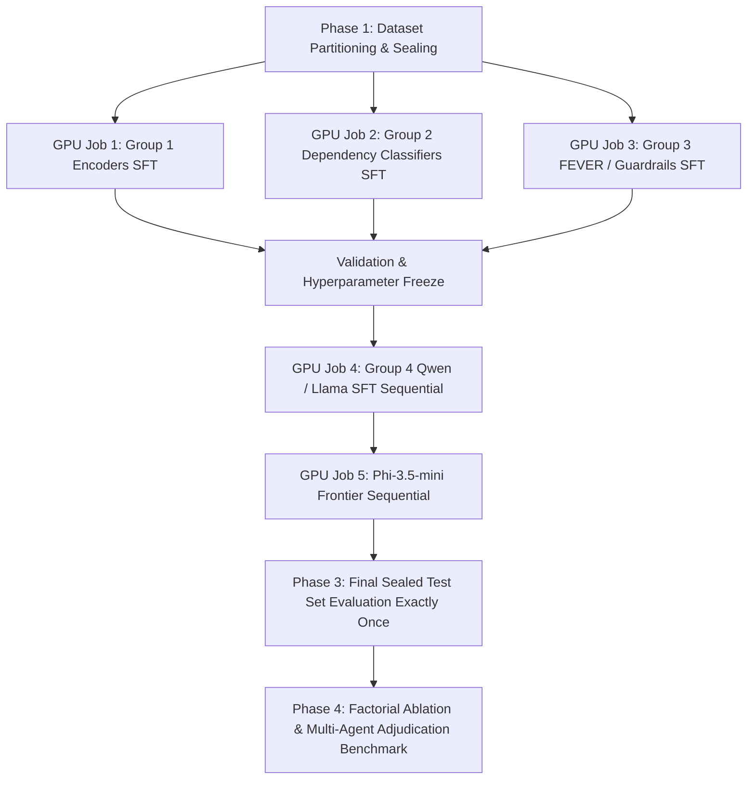

# NVIDIA Laboratory Training Roadmap
**Project:** Verifiable Multi-Agent Fault-Tolerant Adjudication System with Cryptographic Causal Provenance  
**Repository:** [https://github.com/Its-soul/cap-stone](https://github.com/Its-soul/cap-stone)  
**Investigation Date:** October 2026  
**Author:** Senior AI/ML Research Scientist & MLOps Specialist  

---

## 1. Laboratory Overview & Multi-Tier Hardware Topology

Following local 1-epoch feasibility verification on the laptop, extensive training and rigorous comparative benchmarking will be conducted in the university laboratory. Because university server availability fluctuates, this plan does not assume a single monolithic hardware setup. Instead, it defines standardized execution profiles for **three distinct hardware tiers**:

```
+---------------------------------------------------------------------------------------------------+
| HARDWARE TIER 1: Enterprise Research Node (Preferred)                                             |
| - GPU        : 1x or 2x NVIDIA A100-SXM4 (40GB / 80GB) or H100 (80GB)                            |
| - Precision  : Native Brain Floating Point (`bf16`) with TensorFloat-32 (TF32)                    |
| - Target     : Full fine-tuning of ModernBERT (8k context), LoRA for Phi-3.5-mini and Llama-3.2   |
+---------------------------------------------------------------------------------------------------+
| HARDWARE TIER 2: High-End Workstation Node (Standard Lab Server)                                  |
| - GPU        : 1x NVIDIA GeForce RTX 4090 / 3090 (24GB VRAM) or RTX 6000 Ada                     |
| - Precision  : `bf16` or `fp16` with FlashAttention-2 enabled                                     |
| - Target     : Full fine-tuning of all Encoders (Groups 1–3), LoRA SFT for Qwen2.5 & Llama-3.2    |
+---------------------------------------------------------------------------------------------------+
| HARDWARE TIER 3: Constrained Shared GPU Node (Fallback Lab Server)                                |
| - GPU        : 1x NVIDIA RTX 3060 / 4060 / T4 (8GB - 12GB VRAM)                                   |
| - Precision  : `fp16` mixed precision; 4-bit NormalFloat (QLoRA) for generative models            |
| - Target     : Encoder full fine-tuning; QLoRA for Group 4 LLMs                                   |
+---------------------------------------------------------------------------------------------------+
```

---

## 2. Multi-Tier Hyperparameter Configurations

The table below details the training hyperparameters calibrated for each model family across the three hardware tiers:

| Model Family & Checkpoint | Parameters | Hardware Tier | Batch Size (Effective) | Max Seq Len | Learning Rate | Optimizer | Mixed Precision | Epochs & Early Stopping | Checkpoint Strategy |
| :--- | :--- | :--- | :--- | :--- | :--- | :--- | :--- | :--- | :--- |
| **Group 1: MiniLM-L6** | 66M | Tier 1 / 2 / 3 | 32 (32 × 1) | 512 | 3e-5 | AdamW | `bf16` / `fp16` | 10 epochs (Patience = 3 on Val F1) | Best 2 checkpoints |
| **Group 1: DeBERTa-v3-small** | 141M | Tier 1 / 2 / 3 | 16 (16 × 1) | 512 | 2e-5 | AdamW | `bf16` / `fp16` | 8 epochs (Patience = 2 on Val F1) | Best 2 checkpoints |
| **Group 1: ModernBERT-base** | 149M | Tier 1 / 2 | 8 (8 × 1) | 4,096–8,192 | 2e-5 | AdamW | `bf16` (FlashAttn-2) | 6 epochs (Patience = 2 on Val Loss)| Best 2 checkpoints |
| **Group 2: DeBERTa-v3-dep** | 141M | Tier 1 / 2 / 3 | 16 (8 × 2) | 512 | 2e-5 | AdamW | `bf16` / `fp16` | 10 epochs (Patience = 3 on Val F1) | Best 2 checkpoints |
| **Group 2: BGE-small-en** | 33.5M | Tier 1 / 2 / 3 | 64 (64 × 1) | 512 | 3e-5 | AdamW | `bf16` / `fp16` | 5 epochs (Cosine annealing) | Best 2 checkpoints |
| **Group 3: DeBERTa-FEVER** | 435M | Tier 1 / 2 | 16 (8 × 2) | 512 | 1.5e-5 | AdamW | `bf16` / `fp16` | 8 epochs (Patience = 2 on Val F1) | Best 2 checkpoints |
| **Group 3: Llama-Guard-3-1B** | 1.23B | Tier 1 / 2 / 3 | 8 (2 × 4) | 1,024 | 1e-4 | AdamW (LoRA $r=16$) | `bf16` / `fp16` (Tier 3: QLoRA) | 5 epochs (Patience = 2) | Best 1 checkpoint |
| **Group 4: Qwen2.5-0.5B** | 494M | Tier 1 / 2 / 3 | 16 (4 × 4) | 1,024 | 2e-4 | AdamW (LoRA $r=16$) | `bf16` / `fp16` | 5 epochs (Patience = 2) | Best 2 checkpoints |
| **Group 4: Llama-3.2-1B** | 1.23B | Tier 1 / 2 / 3 | 8 (2 × 4) | 2,048 | 1e-4 | AdamW (LoRA $r=16$) | `bf16` / `fp16` (Tier 3: QLoRA) | 5 epochs (Patience = 2) | Best 2 checkpoints |
| **Group 4: Phi-3.5-mini** | 3.82B | Tier 1 / 2 | 4 (1 × 4) | 2,048 | 5e-5 | AdamW (LoRA $r=32$) | `bf16` (Tier 2/3: QLoRA 4-bit) | 4 epochs (Patience = 1) | Best 1 checkpoint |

---

## 3. Parameter-Efficient Fine-Tuning (PEFT / LoRA) Specifications

For generative language models and guardrails (Groups 3 and 4), parameter-efficient fine-tuning preserves base model reasoning while adapting domain syntax:

```python
# Standardized PEFT / LoRA Configuration for Laboratory Experiments
from peft import LoraConfig, TaskType

lora_config_generative = LoraConfig(
    task_type=TaskType.CAUSAL_LM,
    r=16,                           # Low-rank dimension
    lora_alpha=32,                  # Scaling factor (alpha = 2 * r)
    target_modules=[
        "q_proj", "k_proj", "v_proj", "o_proj", 
        "gate_proj", "up_proj", "down_proj"
    ],
    lora_dropout=0.05,
    bias="none"
)

# For Tier 3 (<= 12GB VRAM), initialize with 4-bit NormalFloat (BitsAndBytes):
from transformers import BitsAndBytesConfig
import torch

qlora_config = BitsAndBytesConfig(
    load_in_4bit=True,
    bnb_4bit_quant_type="nf4",
    bnb_4bit_compute_dtype=torch.bfloat16,
    bnb_4bit_use_double_quant=True
)
```

---

## 4. Hyperparameter Search Strategy (Optuna Bayesian Optimization)

To eliminate arbitrary hyperparameter selection, a 30-trial Optuna Bayesian search using Tree-structured Parzen Estimator (TPE) will optimize the validation objective:

```
Objective Function: Maximize Validation Macro-F1 (or Minimized ECE for calibrated probabilities)
Search Parameter Space:
- Learning Rate     : Log-uniform float [5e-6, 3e-4]
- Warmup Ratio      : Uniform float [0.03, 0.15]
- Weight Decay      : Log-uniform float [1e-4, 1e-1]
- Batch Size        : Categorical int [8, 16, 32]
- LoRA Rank (LLMs)  : Categorical int [8, 16, 32]
```

### Triplicate Multi-Seed Protocol:
After the optimal hyperparameter configuration is identified on validation splits:
1. Every model is trained across **three independent seeds** (`42`, `101`, `2024`).
2. Results on the final held-out test set are reported as $\text{Mean} \pm \text{Standard Deviation}$ to verify stability against random initialization.

---

## 5. Experiment Tracking, Metrics Logging & Checkpoint Lifecycle

```
+---------------------------------------------------------------------------------------------------+
| MLOPS EXPERIMENT TRACKING ARCHITECTURE                                                            |
+---------------------------------------------------------------------------------------------------+
| Tracking Backend   : Weights & Biases (W&B) and local MLflow instance (`_private/mlflow/`)         |
| Logged Curves      : Training loss, validation loss, validation macro-F1, learning rate schedule  |
| Artifact Logging   : Confusion matrices, precision-recall curves, ROC curves, calibration plots    |
| System Telemetry   : GPU VRAM utilization, GPU temperature, power draw, throughput (samples/sec)  |
| Model Checkpoints  : Saved to persistent laboratory storage:                                      |
|                      `/lab_checkpoints/<group_name>/<model_name>_seed_<seed>/`                    |
+---------------------------------------------------------------------------------------------------+
```

---

## 6. Execution Dependency Matrix: Parallel vs. Sequential Jobs

To maximize university GPU cluster efficiency while preserving experimental integrity:



### Execution Rules:
1. **Parallelizable Jobs:** Group 1 (NLI), Group 2 (Dependency Classifiers), and Group 3 (Evidence Verifiers) can run concurrently on separate GPUs because their data and model weights are completely disjoint.
2. **Sequential Jobs:** Group 4 (Generative LLMs) requires substantial GPU VRAM and must run sequentially to avoid out-of-memory errors.
3. **Strictly Blocked:** The final held-out test set evaluation (Phase 3) is strictly blocked until all validation runs complete and all hyperparameters are permanently frozen.
